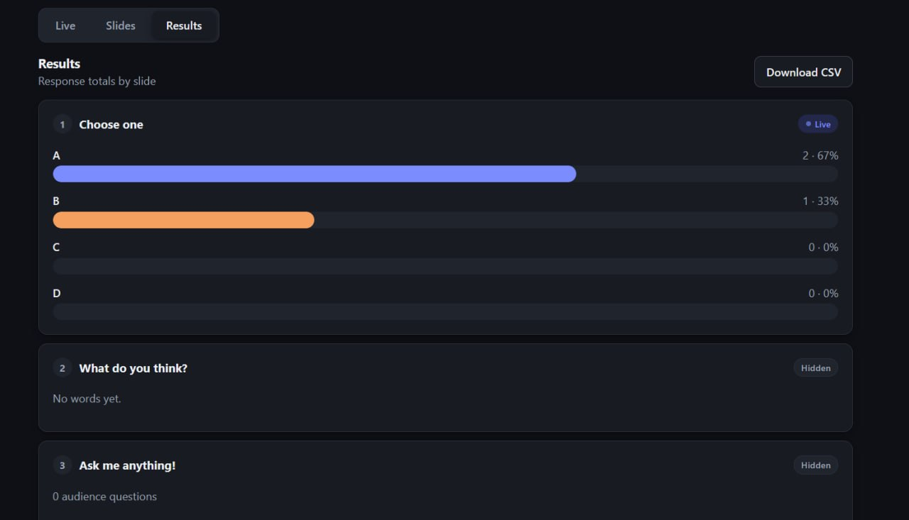
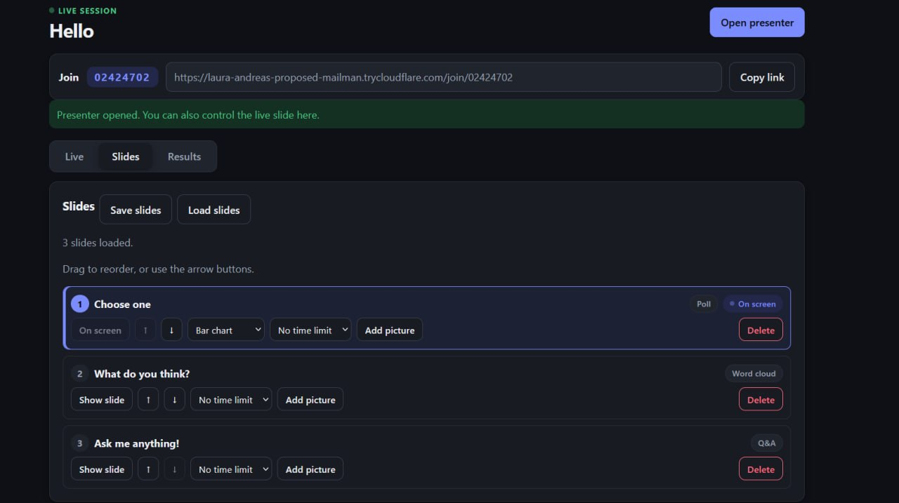
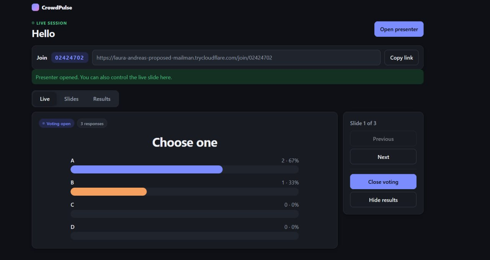
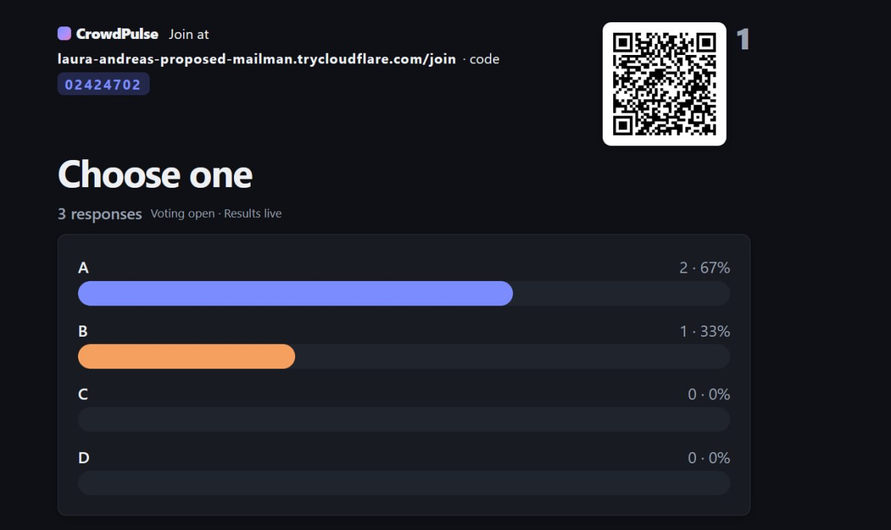

# CrowdPulse

CrowdPulse is a live polling app for event hosts and audiences. Run it on your computer and share it with phones through a temporary Cloudflare link.

## Technology stack


FastAPI serves the app and its browser interface, SQLite stores session data, and Docker Compose runs the app alongside a Cloudflare Quick Tunnel for sharing it with participants. Live updates use WebSockets.

## Screenshots

### Live results



Results displayed as participants respond.

### Slide editor



Prepare and arrange questions before presenting.

### Host live view



Control the active question during a session.

### Presenter view



Display the session on a shared screen.

## Quick setup

You need Git, Docker Desktop with Docker Compose, and Python 3.

```sh
git clone https://github.com/ewonglh/autonomous-sg-2026.git
cd autonomous-sg-2026
python scripts/start_local.py
```

If Python 3 is named differently on your system, use `python3 scripts/start_local.py` on macOS/Linux or `py -3 scripts/start_local.py` on Windows.

On Windows, you can also double-click `scripts/host.bat` for a menu to start hosting, show the temporary link, or stop while keeping responses.

The Python command starts Docker Compose in the background, waits for the app to become healthy, then opens <http://localhost:3000/host>. Create a session and add questions. The app finds the temporary Cloudflare link automatically and uses it for the participant link and presenter QR.

The first start may take a few minutes. The temporary link changes whenever the tunnel restarts.

## Stop the app

```sh
docker compose down
```

The named volume `app_data` stores the SQLite database at `/data/crowdpulse.db`. Responses persist across `docker compose down` and `docker compose up`; `down` keeps named volumes. Do not use `docker compose down -v`, which deletes the database.

## Troubleshooting

- `failed to connect to the docker API`: Docker Desktop is not running. Start it and wait until it is ready.
- Port 3000 already in use: stop whatever else uses it, or change the left-hand number in `compose.yaml` (`"127.0.0.1:3000:8000"`).
- No public link appears on the host page: wait 10 seconds, then run `docker compose restart tunnel`.
- Tunnel link does not load on mobile data: restart the tunnel and wait for the host page to show the new link.
- Q&A slide creation fails after pulling the Q&A schema update: stop local development, then remove `crowdpulse.db` from the repo root before restarting. This deletes local sessions and responses; Docker's separate `app_data` volume is unaffected.
  - Git Bash, macOS or Linux: `rm crowdpulse.db`
  - PowerShell: `Remove-Item -LiteralPath .\crowdpulse.db`
- App changes not showing: rebuild with `docker compose up --build -d`.
- Live updates stop working: run only one app container. The WebSocket manager is in memory.

## Local development

Install Python dependencies into this repo's `.venv` with `sh scripts/install`, then run `sh scripts/dev`. Set `PORT` to choose a local port; it defaults to 3000.

## Project demo

1. Host creates a session with a multiple choice question and a word cloud question.
2. Participants join on their phones and submit answers; the presenter displays live results.
3. Host closes voting, changes questions, reveals results, and downloads a CSV.

## Response export (CSV)

The host can download responses from `/api/sessions/{code}/export.csv`. The export has one row per response and uses UTF-8 with a byte order mark so Excel opens it correctly. Columns, in order:

1. `session_code` — session code
2. `question_order` — slide order in the session
3. `question_type` — multiple choice or word cloud
4. `question_text` — slide text
5. `answer` — chosen option or free text
6. `participant_id` — anonymous browser ID
7. `submitted_at_utc` — response time
8. `qa_upvotes` — reserved for Q&A export; blank in this CSV

Text cells starting with `=`, `+`, `-` or `@` are prefixed so spreadsheets do not run them as formulas. Q&A submissions and votes are not included in this response export.

## Contributing

New teammates read `docs/START-HERE.md`, then for each GitHub issue run `sh scripts/worktree new <N> <slug>`. `AGENTS.md` has the rules.

## Team

- LimZiJing: session, question, and response APIs
- duncanlau06: host, participant, and presenter screens
- ewonglh: packaging, CSV export, integration, and README

See [docs/PROJECT.md](docs/PROJECT.md) for the current scope, module owners, deadline status, and demo path.

## Licence

MIT. See [LICENSE](LICENSE).
